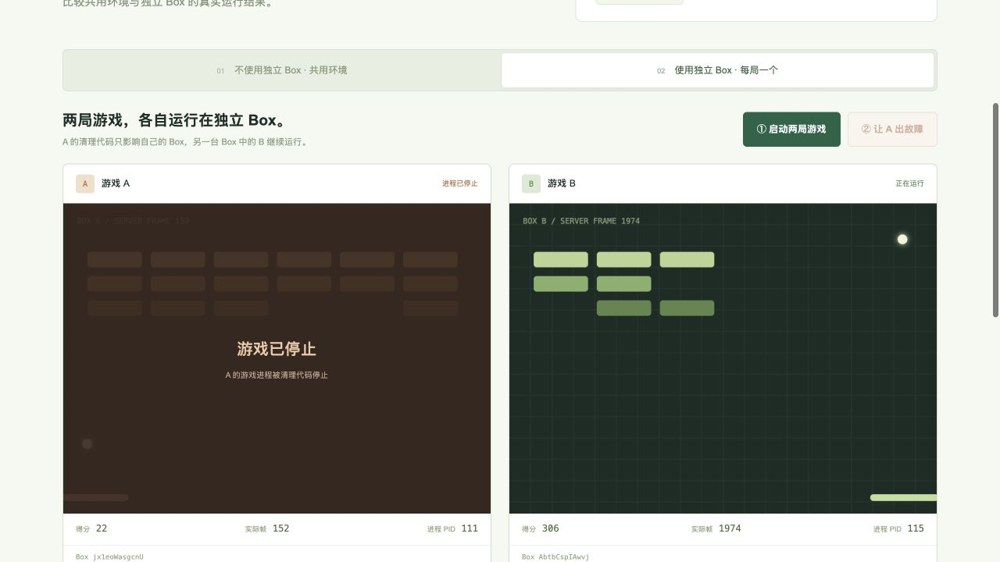

# BoxLite Sandbox Demo

**A live customer demo: break task A and watch whether task B survives.**

Two auto-playing breakout games make failure containment visible. First, run both games in one shared Box and trigger a faulty cleanup operation: both stop. Then put each game in its own Box and repeat the same operation: A stops while B keeps running.

This project is a presentation aid for customer conversations about isolated execution environments. The Python game processes and HTML service run inside **real local BoxLite microVMs**. The browser renders their live state, including Box IDs, process IDs, and advancing frame counters.

[中文演示讲解稿](docs/PRESENTATION.zh-CN.md) · [Mac 使用说明](使用说明.md) · [Download the Mac demo](https://github.com/azhang50-commits/boxlite-sandbox-demo/releases/latest)



## What the comparison shows

| Layout | Where the games run | After the same faulty cleanup in A's Box |
| --- | --- | --- |
| Shared environment | A and B are separate processes in one Box | Both game processes stop |
| Independent environments | A and B run in different Boxes | A stops; B's real frame counter keeps increasing |

Both layouts use BoxLite. The shared layout represents workloads sharing one execution environment; it is not a benchmark against all non-BoxLite systems. The injected fault is a fixed, scoped game-process cleanup, not a VM crash or a sandbox escape. It does not stop arbitrary host processes.

## Run on a Mac

Requirements: an **Apple Silicon Mac**, Python **3.10+**, and internet access for the initial SDK and container-image downloads. The tested SDK version is pinned in `requirements.txt`.

1. Download and unzip **BoxLite-Demo-Mac.zip** from [Releases](https://github.com/azhang50-commits/boxlite-sandbox-demo/releases/latest).
2. Double-click **Start BoxLite Demo.command**.
3. In the native system dialog, leave the Cloud API Key blank and choose **启动演示**. The local demo does not require an account or API Key.
4. The browser opens automatically. Click **带我看一遍** to run both scenarios, or use the mode tabs and start/fault buttons manually.

Keep the Terminal window open. A session lasts up to **15 minutes**; press **Ctrl+C** to stop it sooner. Double-click the launcher again to start a new session. Each session creates or reuses two local Boxes, configured with 1 CPU and 512 MiB memory each. Boxes stop when the session ends; their cached images and local disks remain for subsequent launches.

You can also clone and run from Terminal:

```sh
git clone https://github.com/azhang50-commits/boxlite-sandbox-demo.git
cd boxlite-sandbox-demo
zsh 'Start BoxLite Demo.command'
```

The launcher creates its Python environment, runtime data, and optional credential file under `~/Library/Application Support/BoxLiteDemo`. A Key entered in the dialog is stored locally with restricted file permissions; it is **not used for this local session**, sent to a Box, or embedded in the page. There is no web form for entering keys. Share the release ZIP or repository, not your local runtime directory.

Windows is not included in this release. The launch script and native dialog are for macOS. This is a local presentation, not a hosted public demo link: each presenter runs their own copy.

## A short customer walkthrough

“These two games represent two tasks running at the same time. In the shared environment, a faulty cleanup in task A also stops B. Now we give each task its own Box and repeat the same cleanup. A stops, but B keeps running. The useful difference is the boundary between tasks: a mistake in one environment does not reach the other game's process.”

Point to the Box IDs and frame counters as you speak. The guided tour runs the real start and fault operations; it does not play a prerecorded result. Show the code and download the JSON evidence from the page when a customer wants to inspect what happened.

## How it works

```text
Mac launcher: native dialog + local BoxLite SDK + loopback tunnels
  ├─ Worker Box: game A; also game B in the shared scenario
  └─ Controller Box: HTML/API service; game B in the independent scenario
       └─ Browser: render live Python game state
```

The controller calls a small authenticated game agent in the worker Box. Browser actions are restricted to fixed demo operations. In the independent scenario, the controller checks that B's actual tick count continues to increase after A stops. A disconnected stream is not treated as a successful isolation result. Game processes have bounded lifetimes.

## Source and validation

| Path | Purpose |
| --- | --- |
| `Start BoxLite Demo.command` | Mac setup and launch |
| `work/boxlite-connect/local_demo.py` | Local VM lifecycle, file deployment, and tunnels |
| `work/boxlite-connect/native_key.py` | Native optional Key dialog and local storage |
| `work/box-demo/game_worker.py` | Actual Python game physics and state |
| `work/box-demo/game_agent.py` | Scoped game start/fault operations |
| `work/box-demo/game_backend.py` | Scenario orchestration and evidence checks |
| `work/box-demo/play/` | Presentation UI |
| `work/box-root/server.py` | HTTP service running in the controller Box |
| `tests/` | Game-host, stream, recovery, and credential-file checks |

Shared and independent scenarios, plus the browser's full guided tour, were verified on an Apple Silicon Mac. The latest local test suite has 12 passing tests. See [validation notes](docs/VALIDATION.md) for scope and limits. A fresh installation on another person's Mac has not been independently verified.

```sh
python3 -m unittest discover -s tests -v
node --check work/box-demo/play/game.js
zsh -n 'Start BoxLite Demo.command'
```

Some source modules retain Cloud deployment support from development. The supported entry point for this release is the **local Mac launcher**; entering another account's Key does not switch it to Cloud. The original cloud checkpoint remains in Git history, rather than in the current download.
